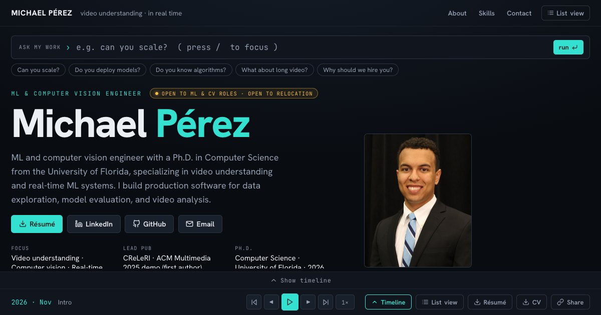

# michaelfperez.com — "THE CUT"

My portfolio, built as a video editor. Live at **[www.michaelfperez.com](https://www.michaelfperez.com)**.



I work on video understanding, so the site is an NLE timeline of my career (2018 → now) instead of a page of sections. Drag the playhead and the monitor above shows whatever existed at that moment — publications with PDF previews, projects with media, and concurrent roles and degrees in a fixed rail. Press <kbd>Space</kbd> and it plays.

## Features

- **Scrubbable timeline** — experience / research / project tracks over education eras, with temporal zoom (wheel, pinch, or buttons), drag-to-resize, and collapse. Clips are packed into sub-rows once over the full span, so nothing jumps between rows as you zoom or pan.
- **"Ask my work"** — a query console that types out answers with clickable citations that scrub the timeline to the evidence. **No LLM, no API key, no server:** every tier runs in the browser, and the HUD shows which tier answered and the measured latency. How it answers is [below](#how-the-console-answers).
- **Tag filtering** — click any chip on a card (PUBLICATION, FIRST AUTHOR, a skill, a role tag) to see everything sharing that tag as a grid, with the matches lit up in the timeline.
- **Deep links** — `#clip/<id>`, `#q/<query>`, `#tag/<value>`, and section hashes (`#about`, `#skills`, `#contact`) restore the exact view on load; a Share button copies the current link. Open Graph / Twitter Card meta with a preview image for link unfurls.
- **List view** — the entire record as a plain, semantic, screen-reader-friendly document, one click away at all times (top nav and transport bar).
- **Accessibility** — the playhead is an ARIA slider with keyboard scrubbing, WCAG AA contrast throughout, `focus-visible` on all controls, and `prefers-reduced-motion` respected.

## How the console answers

A question goes through these tiers in order ([`store.jsx`](src/redesign/store.jsx)) and stops at the first one that answers:

1. **Curated answers** — written by me for common questions (scale, deployment, real-time work, teaching, team projects, publications, why hire me, and so on). Near-miss typos are corrected against the known vocabulary first, synonyms are added (so "serving" counts as deployment), and topic keys match at word boundaries.
2. **BM25 keyword search** over every clip, with titles weighted above tags and tags above the rest of the text, and the same typo tolerance. When the best match covers every word of the question, its clips are the answer.
3. **In-browser embeddings** (optional) — otherwise the question is embedded with [all-MiniLM-L6-v2](https://huggingface.co/Xenova/all-MiniLM-L6-v2) through [transformers.js](https://github.com/huggingface/transformers.js) and compared by cosine similarity with every curated answer and every clip. A close enough curated answer is served as is; otherwise the nearest clips are listed as the closest matches. This tier catches paraphrases the curated answers aren't keyed on, like "Have you ever taught a class?".
4. **Partial keyword matches, or an overview** — when the embeddings find nothing close (or aren't available), the clips that matched part of the question are listed as the closest matches; when nothing matches at all, a short summary of my work.

Only a skill question ("Do you know…", "Have you used…") whose words all appear in my work gets a "Yes —" from the keyword tier. Any other yes-or-no question, a partial match, or a match found by the embeddings is listed as the closest matches, never as a yes.

The embedding tier loads lazily: nothing is downloaded until the console gets focus (or a question first needs the tier). Then the browser fetches, once:

| What | From |
| --- | --- |
| The transformers.js chunk (about 530 kB before compression) | This site |
| The quantized model (about 23 MB) and its tokenizer and config files | Hugging Face (`huggingface.co`, which redirects the weights to its CDN) |
| ONNX Runtime Web: its WebAssembly runtime (about 5.5 MB compressed) and loader | jsDelivr (`cdn.jsdelivr.net`) |

transformers.js keeps the model and runtime files in the browser's Cache Storage, so a later visit loads them from there instead of the network. The question itself is embedded on your device and never leaves the browser. Once the files are in, the model embeds the curated answers and the clips one text at a time, handing the page back between texts, so the page keeps responding while the tier gets ready; only starting the model itself is one longer step. If a question needs the embedding tier before it is ready, the console waits up to 2.5 seconds for it (a little longer if the model is starting at that moment); if it still isn't ready, or the downloads failed (offline, a blocked CDN), the keyword and overview tiers answer instead.

## How it works

Plain React 18 + Vite. No state, routing, or styling libraries — one reducer, one CSS file. The only other runtime dependencies are react-icons and transformers.js, and transformers.js sits in its own chunk that loads with the console.

| Module | Role |
| --- | --- |
| [`src/data/content.js`](src/data/content.js) | Single source of truth for all content (publications, roles, projects, skills) |
| [`src/redesign/timelineData.js`](src/redesign/timelineData.js) | Maps content onto a decimal-year axis: interval packing, era bands, pause ranges, nearest-clip lookup |
| [`src/redesign/storeCore.js`](src/redesign/storeCore.js) | Pure reducer for the whole app — playhead, zoom window, playback, query state, tag filter |
| [`src/redesign/store.jsx`](src/redesign/store.jsx) | The store provider and actions, including the order the console's tiers run in |
| [`src/redesign/retrieval.js`](src/redesign/retrieval.js) | The local query engine: curated answers, synonym expansion, typo tolerance, BM25, citation tokenizer |
| [`src/redesign/semantic.js`](src/redesign/semantic.js) | The optional embedding tier: lazy model load, similarity thresholds, answers in the same shape as the keyword tiers |
| [`src/redesign/TheCut.jsx`](src/redesign/TheCut.jsx) | The app shell: layout, deep links, keyboard transport, wheel and pinch zoom |
| [`src/redesign/Timeline.jsx`](src/redesign/Timeline.jsx) | The timeline surface: ruler, tracks, playhead, tooltips |
| [`src/redesign/Monitor.jsx`](src/redesign/Monitor.jsx) | The monitor: query console, answer rendering, cards, rails, panels |
| [`src/redesign/TransportBar.jsx`](src/redesign/TransportBar.jsx) | Timecode, play and step controls, playback speed, the timeline toggle, and the List view, résumé, CV and Share links |
| [`src/redesign/ListView.jsx`](src/redesign/ListView.jsx) | The List view: the whole record as one plain document |
| [`src/styles/thecut.css`](src/styles/thecut.css) | All styles |
| [`public/`](public) | Copied into the build as is: `CNAME`, the PDFs in `files/`, images, icons, and `resume/` (a page that gives a shared résumé link a preview card, then opens the PDF) |
| [`documents/`](documents/README.md) | Four master CV-and-résumé sets (general, ML engineer, research scientist, software engineer) built from shared facts; one build produces PDFs, matching Word CVs, and the pair the website serves |

## Run it

Needs Node 20.19+ or 22.12+ (what Vite 7 supports). [`.nvmrc`](.nvmrc) says 24, which is what CI uses.

```bash
npm ci            # install the locked dependency versions
npm run dev       # local dev server
npm run lint      # ESLint
npm run build     # production build to dist/
npm run preview   # serve the production build locally
npm run deploy    # build, then publish dist/ to the gh-pages branch
```

**Deploying.** `npm run deploy` builds the site and pushes `dist/` to the `gh-pages` branch with [gh-pages](https://github.com/tschaub/gh-pages), and GitHub Pages serves that branch. The custom domain comes from `public/CNAME`, which Vite copies into `dist/` on every build, so each deploy keeps it. The deploy script passes `--nojekyll`, so gh-pages adds a `.nojekyll` file that tells Pages to serve the files as they are, without a Jekyll pass. No other dotfile is published, so a stray `.DS_Store` in `public/` never reaches the site.

**CI.** [`.github/workflows/ci.yml`](.github/workflows/ci.yml) runs `npm ci`, `npm run lint` and `npm run build` on every push and pull request, on the Node version in `.nvmrc`. It only checks that the site builds; it never deploys or touches Pages.

**Documents.** The downloadable documents are `public/files/Michael_Perez_CV.pdf` and `public/files/Michael_Perez_Resume.pdf` (also kept as `CV.pdf` and `Resume.pdf` so older links keep working). Rebuild them with `sh documents/build.sh` before running the website build; Vite copies the PDFs into `dist/files/` for publication. The build needs XeLaTeX; [`documents/README.md`](documents/README.md) has the details.

## Credits

- **Type:** [Hanken Grotesk](https://fonts.google.com/specimen/Hanken+Grotesk) and [JetBrains Mono](https://fonts.google.com/specimen/JetBrains+Mono), served by Google Fonts (SIL Open Font License).
- **Icons:** [react-icons](https://react-icons.github.io/react-icons/) (MIT), using [Feather](https://feathericons.com/) (MIT) and [Simple Icons](https://simpleicons.org/) (CC0 1.0). Brand icons are trademarks of their owners.
- **Embedding model:** [all-MiniLM-L6-v2](https://huggingface.co/sentence-transformers/all-MiniLM-L6-v2) by sentence-transformers (Apache-2.0), in its ONNX conversion [Xenova/all-MiniLM-L6-v2](https://huggingface.co/Xenova/all-MiniLM-L6-v2).
- **In-browser inference:** [transformers.js](https://github.com/huggingface/transformers.js) by Hugging Face (Apache-2.0) and [ONNX Runtime Web](https://github.com/microsoft/onnxruntime) by Microsoft (MIT).
- Built with [React](https://react.dev/) and [Vite](https://vite.dev/) (both MIT).
